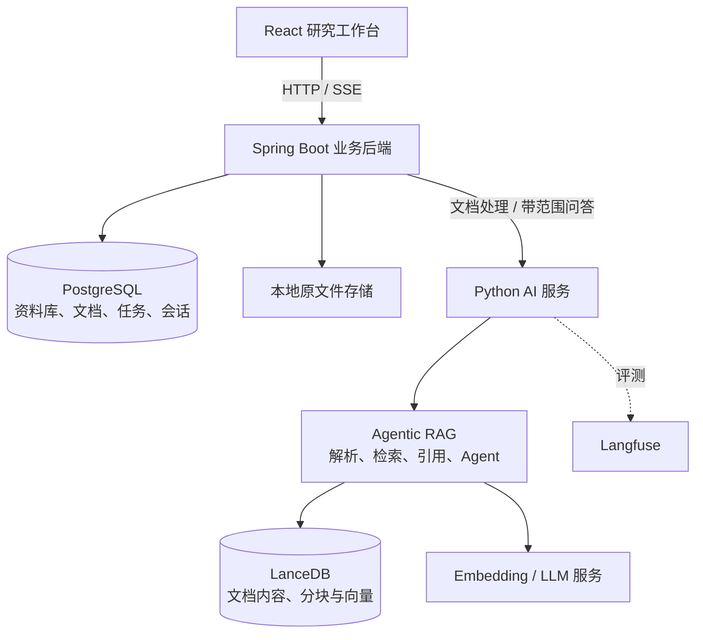

# PaperPartner 科研论文实验的复现研究Agent

## 项目介绍

研究生阶段经常需要对顶刊论文进行复现。阅读论文和技术资料时，我发现一个常见问题：资料已经下载了很多，但要确认某个实验使用了什么数据集、训练参数写在哪里，仍然需要反复搜索和切换文档。将问题直接交给大模型，可以得到流畅的回答，却不容易判断答案来自原文，还是模型补充的推测。

项目围绕“整理资料 → 选择研究范围 → 提问与追问 → 返回原文核对”的流程展开。用户可以创建资料库、上传论文和相关文件，等待自动解析与索引完成后，在指定资料范围内进行多轮问答，并查看回答引用的文件、原文片段，以及可用的页码信息。

## 系统结构



浏览器统一访问 Java 业务接口。Java 管理资料归属、任务与会话状态，Python 处理文档和模型调用。

| 层次 | 主要技术 | 职责 |
| --- | --- | --- |
| 前端 | React、TypeScript、Vite、Ant Design | 资料管理、问答交互、证据展示 |
| Java 后端 | Java 25、Spring Boot 4.1.1、Spring JDBC | 业务校验、事务、任务调度、会话持久化 |
| AI 服务 | Python 3.12+、Starlette、Pydantic AI、Agentic RAG模块 | 文档处理、受限检索、生成与引用 |
| 业务存储 | PostgreSQL、Flyway | 元数据、任务、会话、数据库迁移 |
| 检索与文件存储 | LanceDB、本地文件系统 | 检索索引与上传原文件 |
| 可观测性 | Langfuse、OpenTelemetry | 问答链路追踪与问题定位 |

## 用户主要功能

1. **整理研究资料：** 创建资料库，上传论文与相关文件，查看排队、解析、完成或失败状态。
2. **管理文件：** 预览和下载原文件，修改文件名称，批量删除不再需要的资料。
3. **限定问答范围：** 选择已完成索引的资料创建会话，让不同研究主题使用各自的证据集合。
4. **提问并核对依据：** 查看回答及引用原文，对照文件与页码检查结论。
5. **连续追问：** 在同一会话内继续询问实验条件、方法细节等问题，刷新页面后恢复历史。
6. **处理异常：** 对失败文件重新解析；问答断流时查询原请求结果；证据不足时补充资料或调整问题。


## 核心技术介绍

**资料管理与后台处理：**

- 使用 Spring Boot、Spring JDBC、PostgreSQL 和 Flyway，实现资料库管理、文件上传、处理状态查询与失败重试。
- 上传时流式保存文件并计算 SHA-256，识别同一资料库内的重复内容；将文档记录与解析任务放在同一数据库事务中创建。
- 使用 PostgreSQL 持久化任务，结合行锁、`SKIP LOCKED`、执行租约和令牌，处理并发领取、服务中断恢复及过期结果回写。
- 为 Python 导入建立稳定的业务标识与完成标记，使请求重试能够复用已完成的索引结果。
- 支持文件预览、下载、重命名和批量删除；通过持久化清理任务处理原文件、业务记录与索引之间的删除协作。

**RAG 与多轮问答：**

- 由 Java 确定允许访问的资料范围，Python 在检索与引用工具入口再次约束范围，避免模型自行扩大搜索集合。
- 将回答与引用关联，返回原文片段供用户核对；没有有效引用时，以明确的证据不足提示替换最终答案。
- 分别保存用户可见历史与 Agent 上下文快照，将最终回答、引用、轮次状态和新上下文原子提交。
- 使用会话内唯一的 `requestId` 处理重复请求；已完成请求可以回放结果，减少网络重试造成的重复模型调用。
- 接入 Langfuse，关联一次问答中的模型调用、工具与检索过程，记录耗时、可用的 Token 用量及回答结果。

**前端交互：**

- 使用 React、TypeScript、Vite、Ant Design 和 TanStack Query，构建资料库、文件管理、会话与证据查看界面。
- 通过 SSE 展示检索状态和回答片段，明确区分临时生成内容、最终正文和持久化完成。
- 在断流后保留原问题与请求标识，通过服务端历史或原请求恢复结果；刷新页面后重新读取已保存会话。
- 提供 Markdown 展示、PDF／图片／受限文本预览，以及适配窄屏的证据查看方式。


## 技术心得与设计取舍

### 1. Java 与 Python 如何分工？

项目按职责拆分两层：

- **Java 管业务状态：** 用户当前操作哪个资料库、文件是否就绪、任务是否完成、会话结果是否保存。
- **Python 管 AI 执行：** 如何解析文件、检索证据、调用模型，以及组织引用和上下文。

两层之间通过 HTTP 交换文件、业务标识与处理结果。Java 不需要理解模型内部消息格式，Python 也不决定前端可以访问哪些业务资料。
用相对薄的 Java 后端组织业务流程。需要注意跨服务失败处理的工作，但使业务状态与模型执行各自拥有清晰的边界。

### 2. 上传文件后，为什么使用持久化任务？

文件保存通常较快，但论文解析、向量生成和索引写入可能耗时较长。如果上传接口一直等待全部处理完成，浏览器就容易超时；如果只提交一个内存异步任务，Java 重启后又可能丢失待处理工作。

项目将上传与索引拆开：

```text
保存原文件并计算 SHA-256
          ↓
短事务：保存文档记录 + 创建处理任务
          ↓
返回上传结果
          ↓
后台领取任务 → 调用 Python → 更新处理状态
```

当前使用 PostgreSQL 任务表承接后台工作。它能够与文档记录一起提交，也能保存尝试次数、错误原因和下次执行时间。对于当前的本地部署与处理规模，这比额外引入消息队列更直接。

并发领取时使用 `FOR UPDATE SKIP LOCKED`，让执行器跳过其他线程已经锁定的任务。每次领取生成执行令牌和租约；服务中断后，任务可以在租约到期后被重新领取，旧执行返回时则不能覆盖新状态。

**最终方案：** 用数据库保存待处理工作，使用短事务领取和提交结果，将文件传输与模型调用放在事务之外。上传完成只代表文件已接收，是否可参与问答由索引状态决定。

### 3. 跨 PostgreSQL、磁盘与 LanceDB，怎样处理重复和失败？

一次上传涉及原文件、业务数据库和检索索引，这三者无法依靠一个普通数据库事务同时提交。

例如，Python 已经完成索引，但 Java 在保存结果前中断。恢复后再次发送请求，如果每次都创建新索引，同一个文件就可能出现重复数据。

项目在不同环节使用不同的约束：

- **重复上传：** Java 根据资料库与 SHA-256 识别相同内容。
- **重复建任务：** 使用数据库唯一约束，限制同一文档的处理任务。
- **重复导入：** Python 根据业务命名空间、资料库 ID、文档 ID 和文件哈希构造稳定 URI。
- **导入完成判断：** 同时检查完成标记与文档块，避免把半成品索引当成成功结果。
- **旧请求回写：** Java 核对执行令牌与租约，拒绝失效结果。

原文件写入发生在数据库事务外。正常回滚时执行文件清理；提交结果不确定时保留文件，避免误删数据库可能已经引用的内容。

**最终方案：** 通过持久化任务、幂等导入与失败补偿逐步对齐状态。

### 4. 检索能力之外，为什么还需要资料范围约束？

论文问答同时包含语义问题与精确词语。例如，“方法如何降低计算开销”需要语义理解，而数据集名称、模型缩写和实验编号又需要准确匹配。

项目复用 haiku.rag 的向量与全文混合检索，通过 RRF 融合候选排名；重排等能力由上游提供，可按配置选择。

二次开发还需要解决另一类问题：**内容相关，不代表它属于当前会话允许使用的资料。**

如果用户只选择论文 A，系统却引用了其他论文中相似的实验结果，即使检索分数很高，回答仍然偏离了用户要求。因此：

1. Java 根据业务记录确定已就绪文档及其索引标识。
2. Python 校验文档身份与索引完成状态。
3. 每次调用检索工具时重新施加允许的文档过滤条件。
4. 引用只接受当前会话范围内已检索登记的证据。

**最终方案：** 检索算法负责相关性，业务代码负责资料边界。范围约束落实在工具执行入口，不能只写进提示词。

### 5. 有引用的答案，是否就一定正确？

引用让用户能够核对原文，但“附带引用”本身不能证明回答中的每句话都得到支持。例如，原文只写了训练轮数，模型却进一步推测了学习率，即使附上该段引用，推测部分依然缺乏证据。

当前实现先建立可检查的回答链路：

- 模型先检索，再通过引用工具登记证据。
- 返回文件、原文片段与可用页码，供用户核对。
- 没有有效引用时，用明确的“当前资料中没有足够证据”替换最终回答。
- 为单次执行设置超时与模型请求次数上限，限制反复检索带来的成本。

模型可以调整检索词继续寻找证据，但不能自行扩大资料范围。这个流程复用上游 Agent 能力，由业务代码补充范围、输出与执行限制。

**当前边界：** 已实现引用约束与无有效引用时的拒答兜底；是否充分支持答案、是否遗漏重要条件，仍需要人工标注与专项评测。引用机制提供核对入口，不能替代质量评估。

### 6. 多轮会话为什么要同时保存历史与 checkpoint？

用户看到的历史记录主要包含问题、答案和引用；Agent 继续执行时，还需要模型消息、工具结果与引用状态。

如果只保存最终文字，下一轮虽然能看到“它使用 AdamW”，却可能失去这个结论对应的证据。如果将所有内部状态直接交给前端维护，又会让客户端承担本应由服务端控制的上下文与范围校验。

项目将两类数据分开：

| 数据 | 用途 |
| --- | --- |
| 用户可见历史 | 刷新恢复、历史查看、问题回溯 |
| 服务端 checkpoint | 恢复模型消息、工具与引用状态 |

创建会话时固定文档集合，后续上传的新文件不会自动加入。恢复 checkpoint 时检查会话身份与范围摘要，重新施加服务器确定的资料范围。

最终回答、引用、轮次完成状态与新 checkpoint 在同一事务中保存。失败轮次保留问题和错误，下一轮继续使用上一次成功的上下文。

同时复用上游 evidence compaction，在模型请求中保留此前引用的证据，减少重复携带完整历史检索结果。它保留证据关系，与对全部对话做自由摘要有不同的用途。

**最终方案：** 完整历史用于用户回看，checkpoint 用于执行恢复；两者分开组织，并在一轮成功结束时一起推进。当前仍有上下文存储上限，超长会话需要新建会话。

### 7. SSE 中，什么时候才算回答成功？

流式输出会让用户更早看到内容，但也引入了一个容易忽略的问题：文字已经显示，不代表结果已经保存。

项目使用 SSE 推送状态与回答，并明确事件含义：

| 事件 | 含义 |
| --- | --- |
| `status` | 当前处理阶段，例如开始、检索、引用 |
| `delta` | 临时回答片段 |
| `answer` | 最终完整正文与引用 |
| `done` | 本轮成功完成 |
| `error` | 本轮失败 |

在持久化会话链路中，Java 先保存最终结果和 checkpoint，再向前端发送最终答案与完成事件。前端使用 `answer` 替换临时文字，收到 `done` 后重新读取服务端历史。

网络中断时，前端保留原 `requestId`。如果服务端已经完成，重复请求回放已有结果；仍在执行则提示等待；明确失败的轮次不会因相同请求重发而自动再次调用模型。

同一会话只允许一轮执行，避免两个问题从同一份旧 checkpoint 并发生成并相互覆盖。

**最终方案：** SSE 负责及时展示过程，服务端持久化记录负责确认结果。HTTP 200 或页面已经出现文字，都不能单独作为成功依据。

### 8. 删除文件，为什么还需要后台清理？

一个文件既有 PostgreSQL 业务记录，也有磁盘原文件和 LanceDB 索引。只删除其中一份，会留下索引残留或无主文件；在数据库事务内同步等待所有外部清理，又会增加锁持有时间。

项目先在同一事务中删除业务记录并创建清理任务，后台再清理索引与原文件。暂时失败时保留任务供后续重试。

还需要处理删除与执行之间的竞争：

- 文件正在解析，或正在参与有效的问答执行时，拒绝删除或重命名。
- Python 使用同一把进程内锁串行处理导入与删除。
- 为删除的业务 URI 保存标记，阻止延迟到达的旧导入请求重新创建索引。

**最终方案：** 业务删除与清理任务一起落库，外部资源由后台逐步清理。删除返回后，物理清理可能尚未完成；当前方案按本地 LanceDB 单写入进程设计。

### 9. 如何定位一次问答为什么慢、为什么失败？

一次问答可能包含多次模型请求和检索调用。只记录“问答失败”，无法判断问题发生在检索、模型生成还是流式传输阶段。

项目接入 Langfuse，将一次 Python 问答与内部模型、工具和检索过程关联起来。同一持久化会话使用稳定的会话标识，便于查看连续追问。

当前记录包括模型信息、服务商返回的 Token 用量、耗时、引用数量，以及回答、证据不足、错误或取消等结果。费用能否计算，取决于模型与用量是否匹配 Langfuse 的价格配置。

默认关闭问题、答案和检索正文的内容采集，需要时显式开启。追踪当前覆盖 Python 问答链路，Java HTTP 与文档导入尚未纳入这套追踪。

**最终方案：** 先让执行过程可追踪，为错误分析和后续评测提供依据。接入追踪工具本身不会自动提高回答质量。

## 项目目录

```text
haiku.rag/
├── app/
│   ├── backend-java/       # Spring Boot 业务后端
│   ├── backend/            # Python 服务与业务 RAG 接口
│   ├── web/                # React 前端
│   └── frontend/           # 上游示例前端
├── haiku_rag_slim/          # Agentic RAG 模块核心能力
├── infra/                  # PostgreSQL 本地部署配置
├── evaluations/            # 评测工具
└── tests/                  # 核心测试                  
```

## 本地运行

业务应用需要 PostgreSQL、Python AI 服务、Java 后端和 React 前端分别就绪。当前的 `app/docker-compose.yml` 包含 Python 服务与上游示例前端，尚未整合为研阅应用的一键启动入口。

环境要求：

- Docker 与 Docker Compose；
- JDK 25；
- Python 3.12+，使用 Python 容器运行时无需本机安装；
- Node.js 22.12+、pnpm；
- 可用的问答模型与 Embedding 服务。

推荐启动顺序：

1. 按 PostgreSQL 配置说明 准备数据库。
2. 配置 Python 模型与 LanceDB 路径，启动 Python AI 服务。
3. 按 Java 后端说明 配置数据库连接，启用 `postgres` profile 后启动，默认端口为 `8080`。
4. 启动前端：
   ```bash
   pnpm install --frozen-lockfile
   pnpm dev
   ```


## 验证方式

项目分别验证业务状态、服务协作和前端交互：

| 验证层次 | 主要内容 |
| --- | --- |
| Java 测试 | 参数校验、SQL、事务、重复请求、并发与状态转换 |
| Python 测试 | 导入、资料范围、引用、拒答、checkpoint 与追踪 |
| 前端测试 | SSE 解析、回答状态、文件管理、历史恢复与异常反馈 |
| 隔离集成验收 | 浏览器、Java、Python、PostgreSQL 与 LanceDB 的完整流程 |

Java 常规验证：

```bash
cd /Users/nicoleguo/Documents/CodexProject/haiku.rag/app/backend-java
./mvnw verify
```

真实数据库测试需要专用测试配置；普通 Maven 验证未配置数据库时会跳过相应测试。

前端验证：

```bash
cd /Users/nicoleguo/Documents/CodexProject/haiku.rag/app/web
pnpm check
pnpm test
pnpm build
pnpm test:e2e
```

---


## 致谢

本项目基于 [haiku.rag](https://github.com/ggozad/haiku.rag) 改造。

更多基础能力与配置说明见 [haiku.rag 官方文档](https://ggozad.github.io/haiku.rag/)。

---
