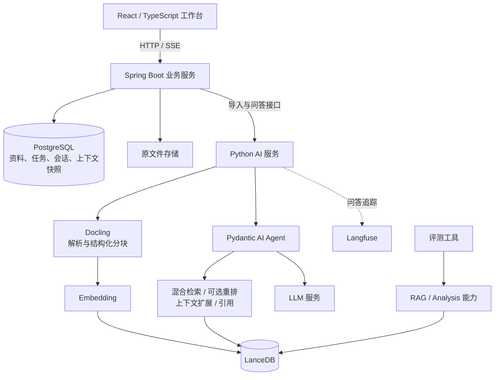

# PaperPartner 科研论文实验的复现研究Agent

## 项目介绍

研究生阶段经常需要对顶刊论文进行复现。阅读论文和技术资料时，我发现一个常见问题：资料已经下载了很多，但要确认某个实验使用了什么数据集、训练参数写在哪里，仍然需要反复搜索和切换文档。将问题直接交给大模型，可以得到流畅的回答，却不容易判断答案来自原文，还是模型补充的推测。

项目以将 **RAG、Agent、Java 业务后端与 React 前端**组织成完整应用，主要分为两条链路。 
- **AI 处理链路：** 文档解析 → 结构化分块 → 向量化 → 混合检索 → 可选重排 → 上下文组织 → 工具调用与引用回答。
- **业务执行链路：** 文件上传 → 持久化任务 → 后台处理 → 状态恢复 → 流式交互 → 会话保存与请求重放。


## 核心能力

| 能力 | 项目中的实现与用途 |
|---|---|
| **文档理解与结构化分块** | 使用 Docling 解析文档，保留标题层级、页码和文档元素关联；支持结构感知的分块策略 |
| **混合检索与排序** | 使用 LanceDB 进行向量与全文检索，通过 RRF 融合排名，可配置 Reranker 对候选进一步排序 |
| **上下文工程** | 按文档结构扩展命中片段，控制上下文长度；多轮问答保留此前引用的证据 |
| **Agent 工具调用** | 使用 Pydantic AI 组织检索、引用与分析工具，允许模型根据已有结果调整检索，并设置执行边界 |
| **可追溯问答** | 回答关联文档、原文片段和可用页码；业务接口约束资料范围，无有效引用时返回证据不足提示 |
| **会话与状态管理** | 分离用户历史和 Agent checkpoint，支持多轮追问、刷新恢复及已完成请求重放 |
| **可靠后台任务** | 持久化任务、短事务、并发领取、有限重试、租约恢复和过期结果拦截 |
| **全栈交互** | React 工作台提供资料管理、SSE 回答、Markdown、引用查看与文件预览 |
| **可观测性与评测** | 使用 Langfuse 追踪 Python 问答过程；提供检索、回答、引用、拒答和多轮评测工具 |
| **扩展入口** | 提供 Python API、CLI、MCP，以及可配置的多模态、沙箱分析与持续导入能力 |


## 用户主要功能

1. **整理资料：** 创建资料库，上传论文和相关文件，查看排队、解析、完成或失败状态。
2. **管理文件：** 预览、下载、重命名与批量删除资料，对失败文件重新发起处理。
3. **确定研究范围：** 选择已完成索引的资料创建会话，将不同研究主题的证据范围分开。
4. **提问与核对：** 查看回答、引用原文和可用页码，判断结论是否得到资料支持。
5. **连续追问：** 在同一会话内进一步询问实验设置、方法细节和相关条件。
6. **恢复结果：** 刷新页面后读取历史；断流时通过原请求标识确认处理结果。

## 系统架构



浏览器统一访问 Java 业务接口。Java 负责资料归属、任务、事务与会话状态，Python 负责文档处理、检索、模型调用与 Agent 上下文。

PostgreSQL 保存业务记录，LanceDB 保存文档内容、分块与向量，原文件独立保留用于预览和下载。

## 技术设计与思考

### 1. 文档解析与分块：先保留结构，再考虑切块大小

论文中的信息具有明确结构。一个数值可能位于表格中，其含义依赖表头；一个实验参数可能写在小节开头，而后文只使用简称。如果简单按固定字符数切分，就可能将结论和条件分开。

项目使用 Docling 生成结构化文档，保留标题、页码、段落、表格等元素关联，再进行分块。切块时可以选择结合结构与 Token 限制的 Hybrid Chunking，或侧重层级结构的 Hierarchical Chunking。

块大小存在实际取舍：

- 较小的块有利于定位具体信息，但容易缺少解释该信息所需的上下文。
- 较大的块保留信息更多，但也会引入无关内容，增加模型输入。

因此，检索阶段以片段定位信息，生成前再根据文档结构补充上下文。命中片段可以向同一章节扩展，并通过字符预算限制扩展范围。

**设计考虑：** 分块质量决定后续检索能看到什么。遇到回答缺少条件时，应先检查解析、切块和上下文组织，而不是直接更换大模型。

### 2. 混合检索：同时处理语义表达与精确术语

研究问题通常混合两种需求：

- “这篇论文如何降低推理开销？”需要理解语义。
- “ALPHA731 实验使用什么优化器？”需要准确匹配实验标识。

向量检索可以处理表达不同但含义接近的问题；全文检索更适合模型名、数据集名、编号等明确词语。项目使用 LanceDB 组合两类检索，并通过 **RRF（Reciprocal Rank Fusion）**融合结果排名。

RRF 根据候选在不同列表中的位置进行融合，避免直接比较数值尺度不同的向量分数和全文检索分数。

配置 Reranker 后，系统可以先召回更多候选，再由重排模型结合问题与片段重新评分，选出最终结果。这样增加了推理开销，因此是否启用，需要观察质量收益与延迟变化。

**设计考虑：** 召回阶段尽量找到相关证据，排序阶段决定哪些证据优先进入上下文；不能只通过增加 Top K 解决所有检索问题。

### 3. Agentic RAG：让模型调整检索，程序限制执行

固定的“一次检索 → 一次生成”适合直接事实问答，但复杂问题可能需要先确认术语，再查实验设置，或使用不同关键词补充证据。

项目使用 Pydantic AI，将知识库能力暴露为工具：

- `rag_search`：检索资料并返回带来源的上下文。
- `rag_cite`：登记支撑回答的文档块。

模型根据当前结果决定是否继续检索，工具结果回填后进入下一轮，最终登记引用并生成回答。这个过程具备动态选择工具和调整检索词的能力。

同时，业务服务控制资料范围、超时和请求预算。模型可以决定如何查找证据，但不能决定自己可以读取哪些资料，也不能无限执行。

**设计考虑：** 对步骤固定的上传与索引使用确定性流程；对检索路径不固定的资料问题使用 Agent 工具循环。当前没有单独构建显式任务规划器或通用反思模块。

### 4. 引用与范围约束：相关证据也必须属于当前研究资料

假设资料库中有多篇研究相似任务的论文，用户只选择其中两篇进行比较。系统即使检索到另一篇高度相关的内容，也不应将其混入本次回答。

项目将范围限制落实到执行过程：

1. Java 根据业务记录确定允许使用的已索引文档。
2. Python 校验文档身份和索引状态。
3. 检索工具在调用时重新施加文档过滤条件。
4. 引用工具只接受会话范围内已检索登记的证据。
5. 最终结果携带文件、原文片段及可用页码。

引用策略要求声明回答依据，允许使用空引用明确表示没有找到支持内容。业务接口在没有有效引用时，返回统一的证据不足提示。

**设计考虑：** 引用让结论可以核对，范围约束保证证据来源符合用户选择。它们仍不能自动证明每个结论都被充分支持，引用正确性需要单独评测。

### 5. Memory 与上下文工程：保存历史和组织模型输入分别处理

多轮追问需要理解“它”“刚才的实验”等指代，但模型需要的上下文并不等于页面上显示的聊天记录。

项目分别管理：

| 状态 | 用途 |
|---|---|
| 用户可见历史 | 保存问题、答案、引用和执行结果，用于刷新恢复与回溯 |
| Agent checkpoint | 保存模型消息和引用等能力状态，用于继续执行 |
| 模型请求上下文 | 从历史和状态组织本轮输入，控制无关证据重复进入模型 |

通过 **Evidence Compaction**，早先问题的检索结果可以在后续模型请求中被替换为实际引用过的证据，其余结果收缩为简短记录。当前问题的检索结果保留，已引用内容继续保持可引用关系。

这一处理发生在模型请求层，不改写保存的完整历史。保留证据仍会随会话增长，因此它并不意味着上下文可以无限扩展。

创建会话时固定文档集合，恢复 checkpoint 时校验会话与范围；只有成功完成的轮次才推进上下文。

**设计考虑：** 当前实现的是持久化会话与证据状态管理，没有自动形成跨会话的用户画像或长期语义记忆。

### 6. 多模态与沙箱分析：根据任务选择处理能力

论文中的关键信息可能位于图表中，部分问题还需要对多份资料进行统计或计算。项目提供两类扩展能力。

**多模态检索与问答：**

- 可以将图片描述转为可检索文本。
- 使用支持图片的 Embedding 模型时，可以进行图文跨模态检索。
- 使用视觉模型时，可以将检索到的图片内容提供给模型分析。

图片是否被保存、是否生成向量、问答模型是否能理解图片，是三个需要分别配置的环节。更换为视觉模型，并不会自动补齐此前没有建立的图片索引。

**沙箱分析：**

Analysis Capability 提供检索、引用和 Python 沙箱执行工具，可读取文档内容及结构信息，适用于统计、聚合和需要计算的分析任务。

当前研究工作台使用受限 RAG 问答路径；沙箱分析主要通过对应 API／CLI 使用。接入业务页面前，仍需要补齐一致的资料范围、结果契约和验收。

**设计考虑：** 简单事实查询使用检索问答；需要计算或结构遍历时使用分析工具；只有问题依赖图片内容时才引入多模态处理。

### 7. Java 与 Python 分工：围绕业务状态划分职责

文档解析和模型 SDK 更适合由 Python AI 层集中处理；资料归属、任务生命周期和会话事务则由 Java 业务层统一管理。

Java 采用 Controller、Service、DAO 分层：

- Controller 处理接口输入与响应。
- Service 组织业务规则和事务。
- DAO 处理参数化 SQL 与数据访问。
- Client 封装对 Python 服务的 HTTP 调用。

数据库结构使用 Flyway 迁移，避免在应用中维护另一套隐式建表逻辑。

Java 与 Python 通过明确的业务标识、文档范围和结果结构协作。前端不直接提交内部 checkpoint，也不自行决定 Python 的检索过滤条件。

**设计考虑：** 服务拆分服务于职责边界。项目没有为了增加组件数量而进一步拆成多个业务微服务。

### 8. 异步处理与任务恢复：上传成功不等于索引完成

文档解析和向量生成耗时较长，如果上传接口一直等待全部处理结束，容易出现超时；只依赖内存异步任务，又可能在进程退出后丢失工作。

项目使用 PostgreSQL 保存任务：

```text
流式保存文件、计算 SHA-256
            ↓
短事务创建文档记录与处理任务
            ↓
返回上传结果
            ↓
后台领取 → 调用 Python → 提交处理结果
```

任务领取使用 `FOR UPDATE SKIP LOCKED` 避免重复领取。每次执行持有独立令牌和租约，任务中断后可以在租约到期后恢复，旧执行不能覆盖新的任务状态。

可重试的服务异常采用有限次数退避重试；确定性失败与不支持格式分别记录，避免无意义地重复处理。

**设计考虑：** 当前业务规模下，数据库任务表能够同时满足持久化和事务要求。HTTP 与模型调用放在数据库事务之外，避免长时间占用连接和锁。

### 9. 幂等与一致性：分别处理每个环节的重复

一次资料处理跨越文件系统、PostgreSQL 和 LanceDB，无法通过一个普通事务同时提交。

项目针对不同重复来源设置不同约束：

| 场景 | 处理方式 |
|---|---|
| 同库重复上传 | 根据 SHA-256 识别相同内容 |
| 同文档重复创建任务 | 数据库唯一约束 |
| Python 已完成，Java 未收到结果 | 稳定业务 URI 与索引完成标记 |
| 旧任务延迟返回 | 执行令牌与租约校验 |
| 用户重复提交同一问题 | 会话内唯一 `requestId` |
| 两轮问答同时修改上下文 | 会话行锁、执行状态约束和版本检查 |

删除资料时，将业务删除与清理任务放在同一事务中，后台清理索引与原文件。Python 保存删除标记，防止延迟到达的旧导入请求重新建立索引。

**设计考虑：** 系统通过持久化状态、幂等操作和补偿逐步对齐结果，并不提供跨数据库、索引与磁盘的原子提交。

### 10. SSE 与全栈状态：明确生成中、已完成和已保存

AI 问答可能经历多轮检索与模型调用，用户需要及时知道系统正在处理什么。项目使用 SSE 推送处理阶段和回答片段。

前端将事件含义区分为：

- `status`：执行进度。
- `delta`：临时生成内容。
- `answer`：最终正文与引用。
- `done`：本轮完成。
- `error`：本轮失败。

在持久化会话中，Java 先将最终回答、引用、轮次状态和 checkpoint 一起提交，再发送最终结果与完成事件。前端用最终正文替换临时片段，并重新读取服务端历史。

断流后保留原问题与 `requestId`。已完成请求重放保存结果，正在执行的请求提示等待，失败请求保留错误状态。

前端使用 TanStack Query 管理服务端数据，临时流状态独立保存；服务端历史是刷新恢复的依据。

**设计考虑：** SSE 改善等待体验，而业务状态保证结果可确认。页面出现文字和 HTTP 200，都不能单独证明问答成功。

### 11. 可观测性：为错误归因保留执行证据

一次回答失败可能由解析缺失、检索偏差、工具调用、模型超时或结果保存失败引起。只有最终答案和一条错误日志，通常不足以定位问题。

项目使用 Langfuse 关联 Python 问答中的 Agent、模型与工具调用，并为业务检索增加独立追踪节点，记录可用的模型信息、Token 用量、耗时、引用数量和执行结果。

同一持久化会话使用稳定会话标识，便于查看连续追问。默认关闭问题、回答和检索正文的内容采集，需要时显式开启。

当前追踪主要覆盖 Python 问答过程，尚未贯通 Java、数据库事务和文档导入的完整调用链。

**设计考虑：** 可观测性提供定位问题的证据。进一步实现自动归因，还需要故障分类、关联规则或经过评测的诊断流程。

### 12. 效果评测：分别检查检索、回答、引用与拒答

回答流畅不等于研究任务完成。评测需要拆开几个问题：

- 相关证据有没有被检索到？
- 证据是否排在足够靠前的位置？
- 回答是否正确使用了证据？
- 引用是否对应支持材料？
- 资料不足时，系统是否正确拒答？
- 多轮追问是否保持上下文一致？

仓库提供独立评测工具，包含 HotpotQA、MTRAG、FRAMES、OpenRAG Bench 等数据集入口，并按任务提供 Recall@K、MRR、nDCG、MAP、回答判定、引用指标和拒答指标等评估方式。

多轮评测既可使用给定历史，也可连续执行对话，观察模型自身回答与工具历史对后续轮次的影响。

工程测试则验证状态与恢复，例如并发请求、服务中断、checkpoint 校验和 SSE 断流。两类验证分别回答“系统是否按设计执行”和“用户问题是否被正确解决”。

**当前状态：** 项目具备评测框架与工程验收入口；论文业务专用的标注集、优化对照结果和持续回归门禁仍待完善，暂不声明未经测量的准确率或性能收益。

## 标准化接口与扩展能力

项目保留多种能力入口，便于按场景使用：

| 入口／模块 | 用途 |
|---|---|
| Java HTTP API | 资料库、文件、会话与业务问答 |
| Python API | 在程序中调用文档处理、检索、问答与分析 |
| CLI | 单文档导入、检索、问答、分析与索引维护 |
| MCP | 向兼容客户端提供标准化资料检索和问答工具 |
| 独立 Ingester | 从文件系统、HTTP、S3、WebDAV 持续同步资料 |
| 检索 Inspector | 查看分块、检索结果、上下文扩展与可用的原文定位 |

独立 Ingester 提供持久化队列、Worker、重试、死信、租约恢复与部分熔断机制。研究工作台的上传任务使用 Java 业务队列，两条入口需要遵守本地 LanceDB 的单写入部署约束，不能直接同时写入同一索引。

## 技术栈与目录

| 层次 | 技术 |
|---|---|
| 前端 | React、TypeScript、Vite、Ant Design、TanStack Query |
| Java 后端 | Java 25、Spring Boot 4.1.1、Spring JDBC、Flyway |
| AI 服务 | Python 3.12+、Starlette、Pydantic AI、haiku.rag |
| 文档与检索 | Docling、LanceDB、Embedding、可选 Reranker |
| 存储 | PostgreSQL、本地文件系统 |
| 可观测性 | Langfuse、OpenTelemetry |
| 验证与部署 | Maven、Python 测试、Vitest、Playwright、Docker |

```text
├── app/
│   ├── backend-java/       # Java 业务服务、任务与会话
│   ├── backend/            # Python AI 接口
│   ├── web/                # 研阅 React 工作台
│   └── frontend/           # 示例聊天界面
├── haiku_rag_slim/          # RAG、Agent、解析与检索能力
├── evaluations/            # 效果评测工具
├── tests/                  # 核心能力测试
├── infra/                  # PostgreSQL 部署配置
└── docs/                   # 技术与配置文档
```

## 本地运行与验证

推荐按照以下顺序启动：

1. 准备 PostgreSQL，配置业务数据库连接。
2. 配置问答模型、Embedding 与 LanceDB 路径，启动 Python 服务。
3. 启动 Java 服务，启用 `postgres` profile。
4. 启动 React 工作台，上传一个小型文档，确认索引完成后创建会话。


---

## 致谢

本项目基于 [haiku.rag](https://github.com/ggozad/haiku.rag) 改造。

更多基础能力与配置说明见 [haiku.rag 官方文档](https://ggozad.github.io/haiku.rag/)。

---
